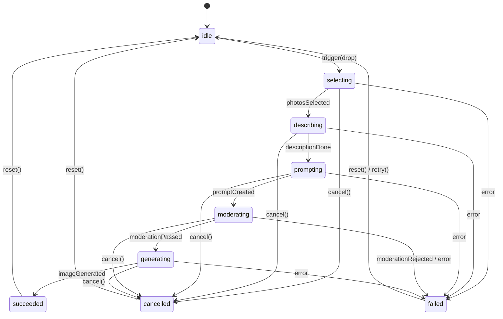

# 技术设计文档 — 记忆炼金（Img Memory Alchemy）

## 概述（Overview）

记忆炼金是一款基于 **Electron + React + TypeScript + Vite** 的桌面应用，由两个 Electron 窗口组成：

- **ControlPage 窗口**：配置目录、皮肤、模式、隐私声明等设置项。
- **Widget 窗口**：常驻桌面的无边框挂件，提供「拖动触发物 → 目标区域松开」的仪式感交互。

整个应用的核心是一条五段流水线（Pipeline），通过 `GenerationJob` 状态机驱动，经由 `ModelGateway` 与模型服务通信，由 `PhotoRepository` 提供本地随机选图能力。

所有文件系统操作、路径验证和网络请求均在 **Electron 主进程**中执行，渲染进程仅通过类型化 IPC 与主进程通信，不直接访问 Node.js API。

---

## 架构（Architecture）

### 进程架构图

```
┌─────────────────────────────────────────────────────────────────────┐
│                        Electron 主进程 (Main)                        │
│                                                                     │
│  ┌─────────────────────┐   ┌───────────────────────────────────┐   │
│  │  PhotoRepository    │   │  GenerationJobService              │   │
│  │  - scan()           │   │  - start(jobId, photos)            │   │
│  │  - filter()         │   │  - cancel(jobId)                   │   │
│  │  - sample()         │   │  - onStateChange(cb)               │   │
│  └─────────────────────┘   └───────────────────────────────────┘   │
│                                                                     │
│  ┌─────────────────────┐   ┌───────────────────────────────────┐   │
│  │  ModelGateway       │   │  ProvenanceStore                   │   │
│  │  - describeImages() │   │  - save(record)                    │   │
│  │  - createPrompt()   │   │  - list()                          │   │
│  │  - moderatePrompt() │   │  - delete(id)                      │   │
│  │  - generateImage()  │   └───────────────────────────────────┘   │
│  └─────────────────────┘                                           │
│                                                                     │
│  ┌─────────────────────┐   ┌───────────────────────────────────┐   │
│  │  ConfigStore        │   │  FileService                       │   │
│  │  - getConfig()      │   │  - saveImageFile()                 │   │
│  │  - setConfig()      │   │  - readImageAsDataUrl()            │   │
│  └─────────────────────┘   └───────────────────────────────────┘   │
│                                                                     │
│  ┌────────────────────────────────────────────────────────────┐    │
│  │  IPC Handler Layer (ipcMain.handle)                        │    │
│  │  channels: photo:*, job:*, config:*, provenance:*, file:*  │    │
│  └────────────────────────────────────────────────────────────┘    │
└─────────────────────────────────────────────────────────────────────┘
                              ↕ contextBridge (preload.ts)
┌─────────────────────────────────────────────────────────────────────┐
│                     渲染进程 (Renderer)                               │
│                                                                     │
│  ┌─────────────────┐   ┌─────────────────────────────────────┐    │
│  │  ControlPage    │   │  Widget Window                       │    │
│  │  React App      │   │  React App                           │    │
│  │  - DirectoryMgr │   │  - SkinLayer (Skin A/B/C)            │    │
│  │  - ExcludeMgr   │   │  - TriggerElement                    │    │
│  │  - SkinSelector │   │  - DropZone                          │    │
│  │  - ModeToggle   │   │  - PipelineStatusPanel               │    │
│  │  - PrivacyNotice│   │  - RevealPanel                       │    │
│  └─────────────────┘   └─────────────────────────────────────┘    │
└─────────────────────────────────────────────────────────────────────┘
```

### 技术选型

| 层次 | 技术 |
|---|---|
| 桌面框架 | Electron 28+ |
| 前端框架 | React 18 + TypeScript 5 |
| 构建工具 | Vite 5 + electron-vite |
| 状态管理 | Zustand（轻量，无需 Redux） |
| 样式 | CSS Modules + CSS 变量（皮肤切换） |
| 单元测试 | Vitest |
| 属性测试 | fast-check（JavaScript PBT 库） |
| Lint | ESLint + Prettier |

---

## 组件与接口（Components and Interfaces）

### IPC Channel 定义

所有 IPC channel 均通过 `preload.ts` 的 `contextBridge.exposeInMainWorld('electronAPI', {...})` 暴露。

```typescript
// src/preload/api.ts — IPC 接口类型定义

interface ElectronAPI {
  // 目录管理
  photo: {
    selectDirectory(): Promise<string | null>;
    addDirectory(path: string): Promise<DirectoryScanResult>;
    removeDirectory(path: string): Promise<void>;
    listDirectories(): Promise<DirectoryEntry[]>;
    addExclusion(path: string, type: 'folder' | 'file'): Promise<void>;
    removeExclusion(path: string): Promise<void>;
    listExclusions(): Promise<ExclusionEntry[]>;
  };

  // 生成任务
  job: {
    start(options: JobStartOptions): Promise<string>; // returns jobId
    cancel(jobId: string): Promise<void>;
    onStateChange(cb: (event: JobStateEvent) => void): Unsubscribe;
  };

  // 配置
  config: {
    get(): Promise<AppConfig>;
    set(partial: Partial<AppConfig>): Promise<void>;
  };

  // 溯源记录
  provenance: {
    save(record: ProvenanceRecord): Promise<void>;
    list(): Promise<ProvenanceRecord[]>;
    delete(id: string): Promise<void>;
  };

  // 文件操作
  file: {
    saveGeneratedImage(dataUrl: string, suggestedName: string): Promise<string | null>;
    openImageViewer(path: string): Promise<void>;
    readThumbnail(path: string): Promise<string>; // returns dataUrl
  };
}
```

### ModelGateway 接口

```typescript
// src/main/gateway/ModelGateway.ts

interface ImageDescription {
  subjects: string[];    // 主体对象
  environment: string;   // 场景/环境
  colors: string[];      // 主要颜色
  mood: string;          // 氛围
  details: string[];     // 细节要素
}

interface GeneratedPrompt {
  text: string;          // 完整 prompt 文本
  theme: string;         // 摘要主题（用于展示）
  style: string;         // 画风
}

interface ModerationResult {
  passed: boolean;
  reason?: string;       // 拒绝时的说明
}

interface GeneratedImage {
  dataUrl: string;       // base64 编码图片
  width: number;
  height: number;
}

interface ModelGateway {
  describeImages(imagePaths: string[], signal: AbortSignal): Promise<ImageDescription[]>;
  createPrompt(descriptions: ImageDescription[], signal: AbortSignal): Promise<GeneratedPrompt>;
  moderatePrompt(prompt: GeneratedPrompt, signal: AbortSignal): Promise<ModerationResult>;
  generateImage(prompt: GeneratedPrompt, referenceImagePath: string, signal: AbortSignal): Promise<GeneratedImage>;
}
```

两种实现：
- `MockModelGateway`：确定性本地实现，用于 DemoMode，不发起任何网络请求。
- `ApiModelGateway`：调用真实 API 服务（Qwen3-VL-Plus、DeepSeek-V4、Qwen-Image-3.0）。

### PhotoRepository 接口

```typescript
// src/main/photo/PhotoRepository.ts

interface PhotoRecord {
  path: string;
  filename: string;
  size: number;
  isValid: boolean;        // 可解码且格式合法
  isExcluded: boolean;
}

interface DirectoryEntry {
  path: string;
  validCount: number;
  isAccessible: boolean;
  errorReason?: string;
}

interface SampleOptions {
  count: 1 | 2 | 3;
  lastBatch?: string[];    // 上一批次路径，用于去重
}

interface PhotoRepository {
  scan(directories: string[], exclusions: string[]): Promise<DirectoryEntry[]>;
  sample(options: SampleOptions): Promise<PhotoRecord[]>;
  getValidPhotos(): PhotoRecord[];
}
```

---

## 数据模型（Data Models）

### AppConfig

```typescript
interface AppConfig {
  mode: 'demo' | 'real';
  skin: 'pixel' | 'magic' | 'paper';
  referenceCount: 1 | 'multi';  // multi = 2 or 3
  directories: string[];
  exclusions: Array<{ path: string; type: 'folder' | 'file' }>;
  widgetBounds: { x: number; y: number; width: number; height: number };
}
```

### ProvenanceRecord

```typescript
interface ProvenanceRecord {
  id: string;                    // uuid
  createdAt: string;             // ISO 8601
  theme: string;                 // 生成主题摘要
  sourcePhotos: Array<{
    path: string;
    filename: string;
  }>;
  savedImagePath?: string;       // 用户选择保存后才填入
  isDemoGeneration: boolean;
}
```

### JobStateEvent

```typescript
type JobState =
  | 'idle'
  | 'selecting'
  | 'describing'
  | 'prompting'
  | 'moderating'
  | 'generating'
  | 'succeeded'
  | 'failed'
  | 'cancelled';

interface JobStateEvent {
  jobId: string;
  state: JobState;
  progress?: number;             // 0–100，生成阶段使用
  error?: { stage: JobState; message: string };
  result?: {
    imageDataUrl: string;
    provenance: ProvenanceRecord;
  };
}
```

---

## 状态机设计（GenerationJob State Machine）

### 状态转换图



### 状态机实现约束

1. 状态只能按定义的转换边前进，非法转换抛出错误并记录日志。
2. 每个 `GenerationJob` 实例持有唯一 `jobId`（UUID v4）和一个 `AbortController`。
3. `cancel()` 调用 `AbortController.abort()`，所有使用该 signal 的 fetch 请求立即终止。
4. 主进程在收到新任务的 `job:start` IPC 前，先检查是否存在进行中的旧 Job；若有，自动取消旧 Job（防止状态覆盖）。
5. 超时策略：每个网络请求设置 60s `AbortSignal.timeout`；超时时 Job 状态转换为 `failed`。

---

## 组件树结构（Component Tree）

### ControlPage 窗口

```
<App>
  <ModeStatusBar />            // 显示 DemoMode / RealMode 标签 + 切换按钮
  <DirectoryManager>
    <DirectoryList>
      <DirectoryItem />        // 路径、有效图片数、移除按钮、错误说明
    </DirectoryList>
    <AddDirectoryButton />
  </DirectoryManager>
  <ExclusionManager>
    <ExclusionList>
      <ExclusionItem />
    </ExclusionList>
    <AddExclusionButtons />    // 排除文件夹 / 排除图片 两个按钮
  </ExclusionManager>
  <ReferenceModeSelector />    // 单图 / 多图 Radio
  <SkinSelector>
    <SkinPreviewCard skin="pixel" />
    <SkinPreviewCard skin="magic" />
    <SkinPreviewCard skin="paper" />
  </SkinSelector>
  <PrivacyNotice />            // 固定文本声明
  <ApiConfigSection />         // RealMode 下显示配置状态
</App>
```

### Widget 窗口

```
<App>
  <WidgetContainer>            // 透明无边框，处理窗口拖拽
    <DemoModeLabel />          // DemoMode 时显示角标
    <SkinLayer skin={currentSkin}>
      <DropZone
        onDragEnter={handleApproach}
        onDragLeave={handleLeave}
        onDrop={handleDrop}
      >
        <DropZoneVisual state={dropState} />  // idle / hover / triggered
      </DropZone>
      <TriggerElement
        draggable
        onDragStart={handleDragStart}
        onDragEnd={handleDragEnd}
      />
    </SkinLayer>

    <PipelineStatusPanel visible={isJobActive}>
      <StageIndicator stage="selecting" />
      <StageIndicator stage="describing" />
      <StageIndicator stage="prompting" />
      <StageIndicator stage="moderating" />
      <StageIndicator stage="generating" />
      <CancelButton />
    </PipelineStatusPanel>

    <RevealPanel visible={jobState === 'succeeded'}>
      <GeneratedImageView />
      <ProvenanceCard />        // 主题、原图缩略图、时间
      <ActionBar>
        <SaveButton />
        <ViewSourceButton />
        <RetryButton />
        <DiscardButton />
      </ActionBar>
    </RevealPanel>

    <ErrorPanel visible={jobState === 'failed'}>
      <ErrorDescription />      // 失败阶段 + 错误原因
      <RetryButton />
      <DiscardButton />
    </ErrorPanel>
  </WidgetContainer>
</App>
```

---

## 皮肤系统设计（Skin System）

### 皮肤定义结构

```typescript
interface SkinAssets {
  id: 'pixel' | 'magic' | 'paper';
  name: string;
  trigger: {
    idle: string;        // SVG 或 PNG 资源路径
    dragging: string;
  };
  dropZone: {
    idle: string;
    hover: string;       // 接近反馈状态
    triggered: string;   // 松开后短暂状态
  };
  background: string;    // Widget 背景
  cssVariables: Record<string, string>;  // CSS 自定义属性
}
```

三套皮肤资源：

| 皮肤 ID | Trigger | DropZone | 接近反馈 |
|---|---|---|---|
| `pixel` | 像素金钥匙 | 像素宝箱 | 宝箱半开 + 发光光晕 |
| `magic` | 魔法药瓶 | 炼金锅 | 炼金锅冒泡动效 |
| `paper` | 纸飞机 | 记忆相册 | 相册封面翻开动效 |

皮肤切换通过更新 `<html>` 上的 `data-skin` 属性实现，CSS 变量覆盖即时生效，无需重渲染整个组件树。

### 触发逻辑

触发判断完全在渲染进程的 Drag & Drop API 中实现：

1. `dragstart` 在 `TriggerElement` 上监听，记录拖拽开始。
2. `dragenter` / `dragleave` 在 `DropZone` 上监听，驱动接近反馈动效。
3. `drop` 在 `DropZone` 上监听 — **只有这个事件才能发起生成**。
4. `dragend` 在 `TriggerElement` 上监听，无论 drop 是否触发，始终将 Trigger 复位（CSS transform 回到初始位置）。

---

## 安全边界设计（Security Boundaries）

### IPC 白名单策略

主进程只注册以下 IPC channels，拒绝任何未登记的调用：

```
photo:select-directory
photo:add-directory
photo:remove-directory
photo:list-directories
photo:add-exclusion
photo:remove-exclusion
photo:list-exclusions
job:start
job:cancel
config:get
config:set
provenance:save
provenance:list
provenance:delete
file:save-generated-image
file:open-image-viewer
file:read-thumbnail
```

### 路径验证策略

主进程在每次文件访问前验证：
1. 路径不能是相对路径（必须是绝对路径）。
2. 访问的文件必须位于用户已授权的目录之内（路径前缀检查）。
3. 扩展名必须在允许白名单内（`['.jpg', '.jpeg', '.png', '.gif', '.webp']`）。

### API Key 保护

- 仅通过 `process.env` 读取，不通过 IPC 传递到渲染进程。
- `ApiModelGateway` 在主进程构造，渲染进程无法访问 Key 值。
- `.env` 文件在 `.gitignore` 中，提供 `.env.example` 替代。

---

## 正确性属性（Correctness Properties）

*属性是对系统正确行为的普遍性描述——一个在所有合法输入下都应当成立的形式化断言。属性是人类可读的规范与机器可验证的正确性保证之间的桥梁。*

属性测试使用 **fast-check**（JavaScript 属性测试库），每个属性最少运行 100 次迭代。

---

### 属性 1：图片格式过滤正确性

*对于任意文件名列表，PhotoRepository 过滤后的结果集只包含扩展名为 `.jpg`、`.jpeg`、`.png`、`.gif`、`.webp` 的文件，且无任何其他格式的文件出现在结果中。*

**验证需求：需求 1.3**

---

### 属性 2：排除列表过滤不变量

*对于任意图片路径列表和任意排除路径列表，PhotoRepository 过滤后的结果集不含任何路径前缀命中排除列表的图片，且所有未命中排除列表的图片均保留在结果集中。*

**验证需求：需求 2.3**

---

### 属性 3：批次内不重复

*对于任意足够大的有效图片池（大于等于抽取数量），PhotoRepository.sample() 返回的图片列表中不存在重复路径。*

**验证需求：需求 3.2、需求 3.4**

---

### 属性 4：历史去重优先

*对于任意图片池（大小 ≥ 2 × 抽取数量）和任意上一批次记录，连续两次调用 PhotoRepository.sample() 所返回的路径集合不完全相同。*

**验证需求：需求 3.4**

---

### 属性 5：GenerationJob 状态机合法转换

*对于任意合法事件序列（drop / descriptionDone / promptCreated / moderationPassed / imageGenerated / cancel / error），GenerationJob 状态机只进行定义图中存在的边上的转换，绝不进入未定义状态。*

**验证需求：需求 7.6**

---

### 属性 6：上传文件集合是抽取结果的子集

*对于任意一次 GenerationJob，传递给 ModelGateway.describeImages() 的文件路径集合是且仅是本次 PhotoRepository.sample() 返回路径的子集，绝不包含抽取结果之外的路径。*

**验证需求：需求 8.3**

---

### 属性 7：DemoMode 零网络请求

*在 DemoMode 下，对任意触发动作和任意配置，MockModelGateway 的所有方法不发起任何 HTTP 请求（网络调用计数恒为 0）。*

**验证需求：需求 11.1**

---

## 错误处理（Error Handling）

| 错误场景 | 处理策略 |
|---|---|
| 目录不可访问 | 扫描时记录错误，UI 显示「无法访问」，该目录不参与抽图 |
| 图片文件损坏 | 跳过该文件，记录跳过数量，不中断扫描 |
| 图片数量不足 | Widget 禁用 Trigger，显示提示，不发起任何调用 |
| API 网络超时（60s）| Job 转 `failed`，显示失败阶段，Trigger 复位 |
| 内容安全审查拒绝 | Job 转 `failed`（moderating 阶段），显示说明，提供重新生成或丢弃 |
| API 返回非 2xx | Job 转 `failed`，显示阶段和错误码，保留重试入口 |
| 用户取消 | Job 转 `cancelled`，AbortController.abort()，Trigger 复位，≤500ms 响应 |
| 缺少 API Key | ControlPage 显示警告，禁止切换 RealMode 进行生成 |
| 旧 Job 结果延迟返回 | 主进程对比 jobId，丢弃不匹配的结果 |

---

## 测试策略（Testing Strategy）

### 双轨测试方案

**单元测试**（Vitest）：
- 针对具体示例和边界条件
- 覆盖 IPC Handler、ConfigStore、ProvenanceStore 的具体行为
- 覆盖错误场景（损坏文件、空目录、缺少 Key）

**属性测试**（fast-check，最少 100 次迭代）：
- 针对上述「正确性属性」章节定义的 7 个属性
- 每个属性测试通过注释标注对应的属性编号，格式：
  `// Feature: img-memory-alchemy, Property {N}: {property_text}`

**集成测试**（Vitest + electron-mock）：
- 端到端 Pipeline 流程（DemoMode）：触发 → 五段状态流转 → 揭晓
- IPC channel 注册验证：确保所有预期 channel 已注册

### 属性测试配置示例

```typescript
// Feature: img-memory-alchemy, Property 1: 图片格式过滤正确性
it('过滤后只保留有效图片格式', () => {
  fc.assert(
    fc.property(fc.array(fc.string()), (filenames) => {
      const result = filterValidImages(filenames);
      return result.every(f => VALID_EXTENSIONS.some(ext => f.endsWith(ext)));
    }),
    { numRuns: 100 }
  );
});
```

### 手动验证清单

- 三套皮肤的接近反馈动效
- Widget 窗口拖动和缩放限制
- Demo 模式全流程体验
- RealMode 上传确认弹窗（需配置 API Key）
