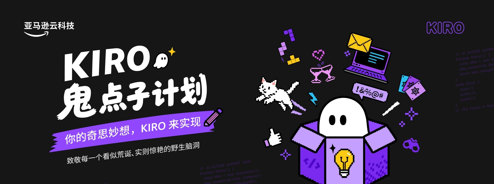
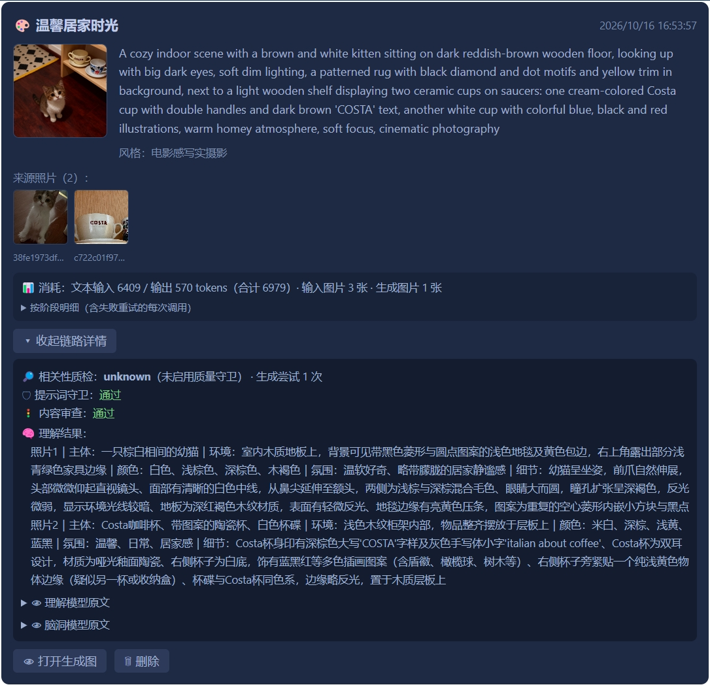

<p align="center">
  
</p>

# 记忆炼金（Image Memory Alchemy）

> 把平常等待 AI 的那几分钟，体验一次「专属于你的记忆的盲盒」

> 一句话：**开盲盒，但盒子里装的是AI为你新生成的照片记忆。**

> 本项目参与 亚马逊云科技(AWS) **KIRO鬼点子计划 - 无用之用 Useless but Useful**

---

## 项目简介

记忆炼金是一款 Electron 桌面应用，通过“两个桌宠”的接触交互来触发应用。它会把本地相册中的照片随机抽取，经由 AI 五段流水线（**选图 → 理解 → 脑洞 → 守门 → 生成**），炼成一幅意想不到的新作品。

<p align="center">
  
</p>

交互功能：把桌面挂件上的触发物（钥匙 / 药瓶 / 纸飞机 / 星星 / 电池 / 蜘蛛）拖入目标区域（宝箱 / 炼金锅 / 窗户 / 许愿瓶 / 电池仓 / 蜘蛛网）并松开进行启动，仪式感满满，且防误触；生成完毕自动弹出揭晓窗口，展示作品与来源。

<p align="center">
  
</p>

---

## ✨ 特性

- **AI把你的图片重新展现**：内置 Demo 模式，本地体验五段流水线，不发任何网络请求；
- **六套桌宠皮肤**：像素宝箱 / 魔法药瓶 / 纸飞机窗户 / 星空许愿瓶 / 电池仓 / 小蜘蛛网，均带拖拽与接近反馈动画；
- **本地随机抽图**：Fisher-Yates 随机抽取，并优先避开上次抽中的照片；
- **创作尺度可调**：保守 / 平衡 / 放飞三档，控制 AI 对原图的保留程度；
- **质量守卫**：提示词守卫 + 内容安全审查 + 生成后相关性自检，不合格自动重试；
- **全链路可观测**：理解原文、脑洞原文、审查结论、质检结论、分阶段用量均可查看；
- **隐私优先**：只上传本次抽中的照片，绝不整目录上传，原始照片永不被改写。

---

## 快速启动（Demo 模式，无需 API Key）

```bash
# 1. 安装依赖
npm install

# 2. 启动（Demo 模式默认开启，无需任何 Key）
npm run dev
```

Demo 模式使用本地预置示例素材，完整走完五段流水线，不发任何网络请求。

---

## 真实模式配置（需要 API Key）

当前真实模式使用三个模型服务：

| 环节        | 模型                   | 服务商           | 所需 Key             |
| ----------- | ---------------------- | ---------------- | -------------------- |
| 图片理解    | `qwen3-vl-plus`      | 阿里云 DashScope | `QWEN_API_KEY`     |
| 脑洞 + 守门 | `deepseek-v4-pro`    | DeepSeek         | `DEEPSEEK_API_KEY` |
| 图片生成    | `qwen-image-2.0-pro` | 阿里云 DashScope | `QWEN_API_KEY`     |

配置步骤：

1. 复制环境变量模板：

   ```bash
   cp .env.example .env
   ```
2. 编辑 `.env`，填入你的 Key：

   ```env
   QWEN_API_KEY=你的阿里云通义千问 API Key
   DEEPSEEK_API_KEY=你的 DeepSeek API Key
   ```
3. 启动后在控制页把模式切换为「真实模式」。

> 说明：模型名与 endpoint 目前硬编码在 `src/main/gateway/` 下的 adapter 中。如需接入其它模型，请参考对应 adapter 修改（后续版本计划支持 `.env` 直接配置模型名）。

---

## 常用命令

| 命令                  | 说明                          |
| --------------------- | ----------------------------- |
| `npm run dev`       | 启动开发环境（热更新）        |
| `npm run build`     | 构建生产包                    |
| `npm run lint`      | ESLint 检查                   |
| `npm run typecheck` | TypeScript 类型检查           |
| `npm run package`   | 打包为可分发安装包（Windows） |

---

## KIRO 深度使用（参赛证据）

本项目全程使用 KIRO 进行**规格驱动开发**（requirements-first 工作流），相关 spec 完整保留在仓库中：

| Spec                                               | 内容                                         |
| -------------------------------------------------- | -------------------------------------------- |
| `.kiro/specs/img-memory-alchemy/requirements.md` | 14 组功能/安全需求，Given/When/Then 验收标准 |
| `.kiro/specs/img-memory-alchemy/design.md`       | 技术设计：架构、状态机、属性测试定义         |
| `.kiro/specs/img-memory-alchemy/tasks.md`        | 分阶段实施计划与依赖图                       |
| `.kiro/specs/widget-independent-pets/bugfix.md`  | 桌宠独立窗口重构的需求                       |

- **工作流**：requirements-first（需求 → 设计 → 任务 → 分阶段交付与迭代）
- **五段流水线**：选图 → 理解 → 脑洞 → 守门 → 生成，天然契合 spec 驱动 + 分阶段编排展示

---

## 技术栈

| 层次     | 技术                               |
| -------- | ---------------------------------- |
| 桌面框架 | Electron 28                        |
| 前端框架 | React 18 + TypeScript 5            |
| 构建工具 | Vite 5 + electron-vite 2           |
| 状态管理 | React Hooks                        |
| 样式     | CSS + inline style + 内联 SVG 皮肤 |
| 测试     | Vitest + fast-check（已配置）      |
| Lint     | ESLint + Prettier                  |

---

## 项目结构

```
src/
├── main/           # Electron 主进程（Node.js）
│   ├── index.ts    # 窗口管理 & 应用入口
│   ├── ipc/        # IPC Handler 注册
│   ├── photo/      # PhotoRepository（扫描、过滤、随机抽样）
│   ├── job/        # GenerationJob 状态机 & Service、promptGuard
│   ├── gateway/    # ModelGateway（Mock + DeepSeek/QwenVL/QwenImage adapter）
│   ├── store/      # ConfigStore + ProvenanceStore
│   └── file/       # FileService（保存、读取）
├── preload/        # contextBridge IPC 接口暴露
├── renderer/       # 渲染进程（React）
│   ├── index.html  # 控制页
│   ├── trigger.html# 触发物窗口（钥匙等）
│   ├── dropzone.html # 目标区窗口（宝箱等）
│   ├── reveal.html # 揭晓窗口
│   └── src/        # App / TriggerApp / DropZoneApp / RevealApp
└── shared/         # 主进程 & 渲染进程共用类型
```

---

## 隐私说明

- 只在本地扫描用户明确授权的目录，随机抽取在本地完成；
- Real 模式下，**仅本次被抽中的照片**会发送给对应模型服务，绝不整目录上传；
- 未选中的照片不会随请求上传；
- API Key 仅读取自本地 `.env` 文件，不会硬编码在源码中；
- 原始照片永不被改写或覆盖，成品需用户主动保存。

---

## 声明

- 本项目仅供学习、娱乐与演示用途；
- 生成内容由 AI 模型产出，可能出现错误、偏见或不符合预期的情况，请用户自行判断；
- 安全审查措施**只能降低风险，不能保证**每一次生成都符合个人心理预期；
- 使用真实模式会调用第三方模型服务，**可能产生费用**，请自行了解各服务商的计费规则；
- 用户对生成内容的使用负责，请遵守相关法律法规及各模型服务的使用条款。
